# AI Laptop Purchase Project

## Project Overview

This project documents a practical laptop purchasing exercise supported by an AI assistant. It examines how AI can help identify buyer requirements, research available laptops, compare alternatives, assess purchasing risks, and develop a professional recommendation.

The project also evaluates the quality of AI-generated responses through human annotation and feedback.

### Project Overview Screenshot

## Project Objectives

- Evaluate AI-generated responses in a realistic laptop purchasing scenario.
- Assess response relevance, accuracy, and helpfulness.
- Identify missing information, errors, and weaknesses in AI responses.
- Compare AI-generated predictions with human evaluations.
- Document evaluation results and supporting evidence.

## Task 1: Buyer Needs Assessment

### Objective

Establish the buyer's programming and computing requirements before recommending a suitable laptop.

### Prompt and AI Response

### Human Evaluation Feedback

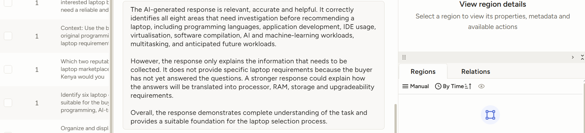

The response correctly identified the eight areas that needed investigation, including programming languages, application development, IDE usage, virtualisation, software compilation, AI and machine learning, multitasking, and anticipated future workloads.

**Identified limitation:** The response explained what information needed to be collected but did not yet translate the questions into specific hardware requirements. The buyer's answers would be needed to establish suitable processor, memory, storage, and upgradeability requirements.

### Task 1 Outcome

The human evaluation confirmed that the AI response provided a relevant and useful starting point for understanding the buyer's needs. The information collected would guide the subsequent laptop selection process.

---

## Project Evidence

Screenshots for each task will be added progressively as the project develops. Each task will include its prompt, AI-generated response, and human evaluation evidence where applicable.

## Skills Demonstrated

- AI response evaluation
- Human annotation and feedback
- Prompt analysis
- Relevance and accuracy assessment
- Critical thinking
- Identification of AI response limitations
- Technical documentation

# AI Laptop Purchase Project

## Project Overview

This project documents a practical laptop purchasing exercise supported by an AI assistant. It examines how AI can help identify buyer requirements, research available laptops, compare alternatives, assess purchasing risks, and develop a professional recommendation.

The project also evaluates AI-generated responses through human annotation, critical review, and feedback.

### Project Overview Screenshot

## Project Objectives

- Evaluate AI-generated responses in a realistic laptop purchasing scenario.
- Assess response relevance, accuracy, and helpfulness.
- Identify missing information, errors, and weaknesses in AI responses.
- Compare AI-generated outputs with human evaluations.
- Document evaluation results and supporting evidence.

---

# Task 2: Highlight the Specifications That Meet the Buyer's Requirements

## Objective

Identify the hardware specifications required to support the buyer's programming activities, particularly AI training and machine learning, while considering the KSh 60,000 budget and anticipated future workloads.

## 1. Task Prompt

The buyer requires a reliable and powerful laptop for:

- AI training and machine learning
- Software development and web development
- Android application development
- Data science
- Virtual machines and Docker containers
- VS Code and Android Studio
- Compiling large software projects
- Running multiple applications simultaneously

The buyer also requires a capable processor, sufficient RAM, fast SSD storage, effective cooling, and good upgradeability.

## 2. AI-Generated Response

The AI translated the buyer's workload into the following recommended hardware specifications:

| Hardware Component | Recommended Specification |
|---|---|
| Processor | Intel Core i5 or i7, preferably 10th or 11th Generation, or comparable AMD Ryzen 5 |
| Processor Cores | At least 4 cores and 8 threads |
| RAM | Minimum 16GB DDR4, preferably upgradeable to 32GB or more |
| Storage | 512GB NVMe SSD |
| Cooling | Effective thermal management |
| Virtualisation | Intel VT-x or AMD-V support |
| Upgradeability | Prefer models supporting RAM and SSD upgrades |
| Operating System | Windows 11 compatibility |

### AI Response Screenshot 1

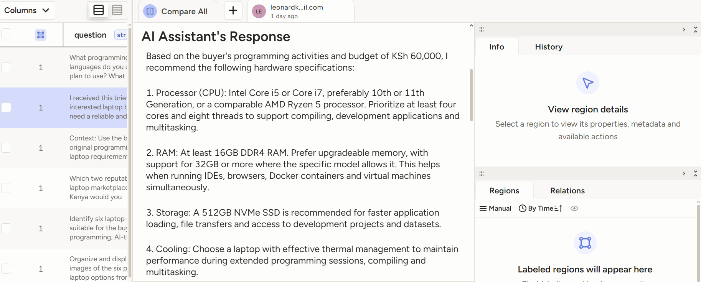

### AI Response Screenshot 2

The AI also clarified that the recommended configuration provides a practical foundation for programming, data science, and AI/ML learning within the buyer's budget. It is not intended for intensive local AI model training.

## 3. Human Evaluation Feedback

The human evaluation recognised that the AI correctly interpreted the buyer's programming and AI/ML requirements and translated them into practical hardware specifications within the KSh 60,000 budget.

The feedback highlighted the following strengths:

- Recommended a capable multi-core processor.
- Identified 16GB DDR4 RAM as the minimum requirement.
- Recommended a 512GB NVMe SSD.
- Considered effective cooling and processor virtualisation support.
- Recognised the importance of upgradeable components.
- Accounted for Android Studio, Docker, virtual machines, software compilation, and multitasking.
- Correctly limited the recommendation to AI/ML learning and less demanding experiments rather than intensive local model training.

### Identified Area for Improvement

The response could be improved by distinguishing minimum specifications from preferred specifications, particularly regarding processor generation, RAM capacity, and upgradeability. This would make the recommendations more precise when comparing actual laptop models.

### Human Evaluation Feedback Screenshot

## 4. Task 2 Outcome

The AI successfully converted the buyer's computing requirements into a practical hardware specification framework.

The human evaluation confirmed that the response addressed the major workload requirements while recognising the limitations of budget laptops for intensive local AI model training.

These specifications provide a technical foundation for the next stage of the laptop purchasing process: researching reputable laptop manufacturers and brands.

# AI Laptop Purchase Project

## Project Overview

This project documents a practical laptop purchasing exercise supported by an AI assistant. It examines how AI can help identify buyer requirements, research available laptops, compare alternatives, assess purchasing risks, and develop a professional recommendation.

The project also evaluates AI-generated responses through human annotation, critical review, and feedback.

### Project Overview Screenshot

## Project Objectives

- Evaluate AI-generated responses in a realistic laptop purchasing scenario.
- Assess response relevance, accuracy, and helpfulness.
- Identify missing information, errors, and weaknesses in AI responses.
- Compare AI-generated outputs with human evaluations.
- Document evaluation results and supporting evidence.

---

# Task 3: Consider Reputable Laptop Brands

## 1. Task Objective

Identify reputable laptop manufacturers whose products are suitable for the buyer's programming and computing requirements established in the earlier assessment.

The focus is on manufacturers with reliable business-class laptop ranges, good build quality, serviceability, capable processors, and potential for future upgrades.

## 2. Task Prompt

The AI was instructed to use the buyer's original programming-laptop requirements already provided in Task 2, without creating or repeating a new buyer request.

## 3. AI-Generated Response

The AI recommended three reputable laptop manufacturers:

### 1. Lenovo

The AI recommended Lenovo, particularly its ThinkPad range, because of:

- Durable construction.
- Comfortable keyboards.
- Good serviceability.
- Potential RAM and storage upgradeability, depending on the model.

### 2. Dell

The AI recommended Dell, particularly its Latitude range, because of:

- Solid construction.
- Practical connectivity.
- Good serviceability.
- Configurations with capable processors and upgradeable storage.

### 3. HP

The AI recommended HP, particularly its EliteBook range, because of:

- Good build quality.
- Security features.
- Serviceability.
- Capable processors.
- Options for memory and storage upgrades, depending on the model.

### AI Response Screenshot

## 4. Human Evaluation Feedback

The human evaluation confirmed that the AI correctly recommended Lenovo, Dell, and HP as reputable manufacturers of programming laptops.

The evaluation recognised that the response:

- Provided relevant reasons for considering each manufacturer.
- Addressed build quality and serviceability.
- Considered processor capabilities and upgradeability.
- Correctly explained that performance depends on the specific laptop model and configuration, not the brand name alone.

### Human Evaluation Screenshot

## 5. Task 3 Outcome

The AI successfully identified three reputable laptop manufacturers and provided relevant reasons for considering their business-class laptop ranges.

The human evaluation confirmed that the recommendations were appropriate and that the response correctly distinguished between brand reputation and the specifications of individual laptop models.

These three manufacturers provide a shortlist of brands to consider when researching reputable online laptop marketplaces in Kenya and identifying suitable laptop options.

---

## Skills Demonstrated

- AI response evaluation
- Human annotation and feedback
- Brand research and analysis
- Critical assessment of AI recommendations
- Identification of relevant product characteristics
- Evidence-based evaluation

# Task 4: Choose a Reputable Online Shop

## Task Objective

Evaluate AI recommendations for reputable online shops in Kenya where the buyer can purchase a laptop that meets their programming and AI/ML requirements.

## 1. Prompt

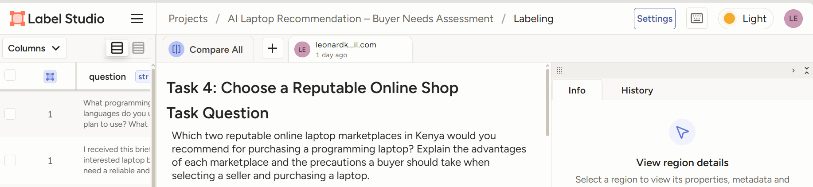

## 2. AI-Generated Response

The AI recommended two online marketplaces: Jumia Kenya and Kilimall Kenya.

### Jumia Kenya

The AI identified Jumia as an option because it offers:

- A wide selection of laptops from different sellers.
- Customer reviews and ratings.
- Different payment and delivery options.
- Official brand stores for some products.

**Potential risks:**
- Not every seller is manufacturer-authorised.
- Warranty coverage and return conditions may vary.
- Buyers need to verify seller credibility and product authenticity.

### Kilimall Kenya

The AI identified Kilimall as another option because it offers:

- A variety of laptop models.
- Competitive prices.
- Customer reviews and order-tracking features.

**Potential risks:**
- Products may be supplied by local or overseas sellers.
- Warranty and return conditions may vary.
- Some listings may lack sufficient hardware configuration details.

### AI's Purchasing Advice

The AI advised checking the following before placing an order:

- Seller credibility and reputation.
- Product authenticity.
- Manufacturer warranty and coverage.
- Return and refund conditions.
- Exact laptop specifications, including processor, RAM and storage.

It also emphasized that buyers should not make purchasing decisions based on price alone.

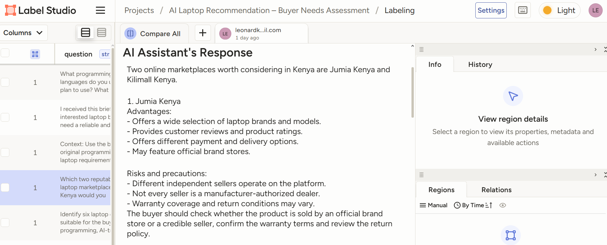

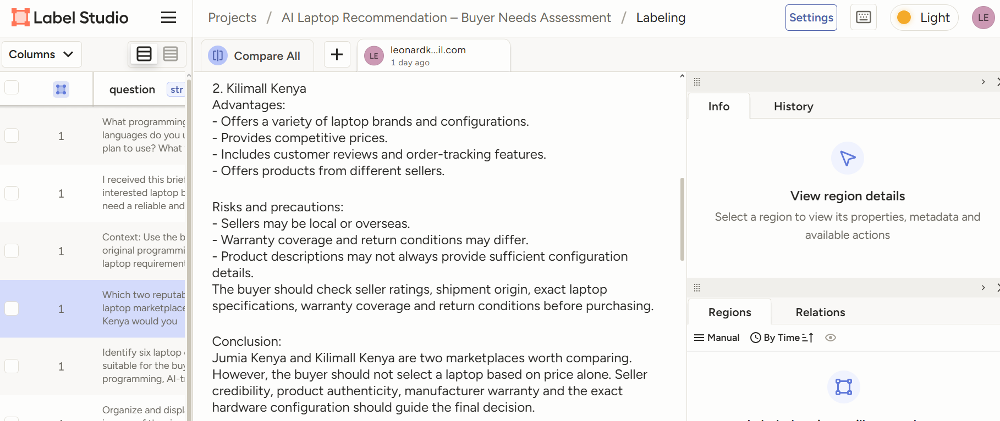

## 3. Human Evaluation and Feedback

The AI response was evaluated for relevance, accuracy and helpfulness.

**Evaluation findings:**

- The response was relevant to the buyer's request.
- It provided a useful comparison of Jumia Kenya and Kilimall Kenya.
- It highlighted important purchasing risks, including seller credibility, warranty coverage and product authenticity.
- It provided practical checks to perform before buying a laptop.

**Areas for improvement:**

The response could be more specific by identifying manufacturer-authorised dealers or official brand stores and explaining how buyers can verify them.

## 4. Task Outcome

The evaluation showed that the AI provided useful guidance for identifying online marketplaces and understanding the risks involved in purchasing laptops online.

However, the recommendations still required further verification, particularly regarding seller authorisation, product authenticity and warranty terms.

# Task 5: Find Laptop Options That Suit the Client's Budget

## Task Objective

Identify six laptop options suitable for the buyer's programming, AI-training and machine-learning requirements, using Jumia Kenya and Kilimall Kenya. Each option must fall within the KSh 60,000 budget.

## 1. Prompt

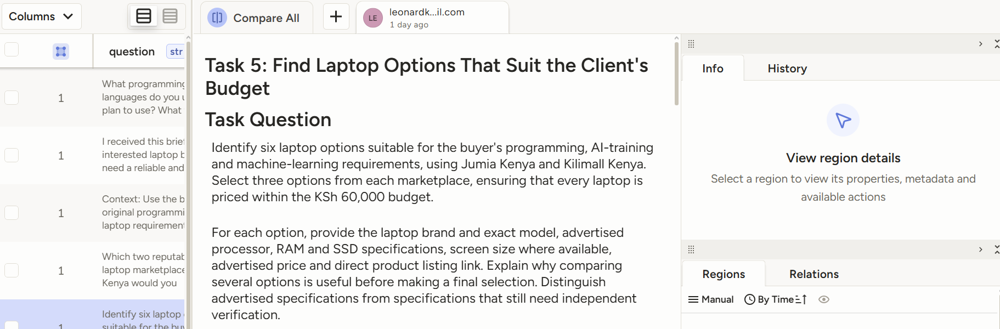

## 2. AI-Generated Response

The AI identified six laptop options, selecting three from Jumia Kenya and three from Kilimall Kenya. All six advertised prices were within the buyer's KSh 60,000 budget.

### Jumia Kenya

**1. HP EliteBook 830 G8**

- Processor: 11th Generation Intel Core i7
- RAM: 16GB
- Storage: 512GB SSD
- Display: 13.3-inch FHD touchscreen
- Advertised price: KSh 50,000

**2. Lenovo ThinkPad T490s**

- Processor: 8th Generation Intel Core i7
- RAM: 32GB
- Storage: 512GB SSD
- Display: 14-inch FHD touchscreen
- Advertised price: KSh 46,500

**3. Dell Latitude 5300**

- Processor: 8th Generation Intel Core i5
- RAM: 16GB
- Storage: 256GB
- Touchscreen display
- Advertised price: KSh 32,999

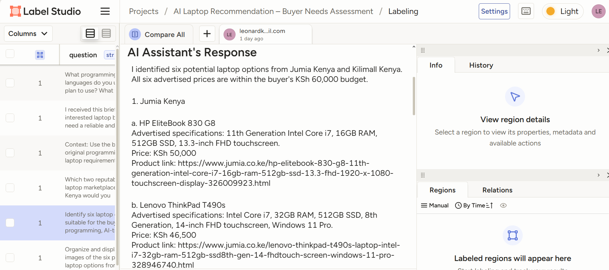

### Kilimall Kenya

**4. HP EliteBook 840 G7**

- Processor: 10th Generation Intel Core i7-10310U
- RAM: 16GB
- Storage: 512GB SSD
- Display: 14-inch FHD touchscreen
- Advertised price: KSh 51,299

**5. Lenovo ThinkPad X13**

- Processor: 10th Generation Intel Core i7
- RAM: 16GB
- Storage: 512GB SSD
- Display: 13.3-inch FHD touchscreen
- Advertised price: KSh 48,800

**6. Dell Latitude 5410**

- Processor: Intel Core i5-10310U
- RAM: 16GB
- Storage: 512GB SSD
- Display: 14-inch Full HD
- Advertised price: KSh 48,127

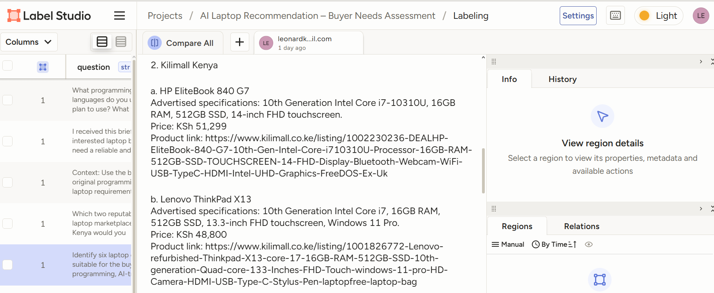

## 3. Proposed Laptop Options

The AI organized the six options by marketplace, making it easier to compare the available models.

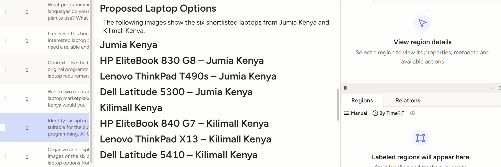

The response also explained that comparing several options helps the buyer assess processor performance, memory, storage, price and suitability for programming workloads.

It advised independently verifying seller-advertised specifications, warranty coverage, seller reliability, physical condition and upgradeability before making a purchase.

## 4. Human Evaluation and Feedback

The response was evaluated using four criteria:

- **Completeness:** Complete
- **Relevance:** Relevant
- **Accuracy:** Accurate
- **Helpfulness:** Helpful

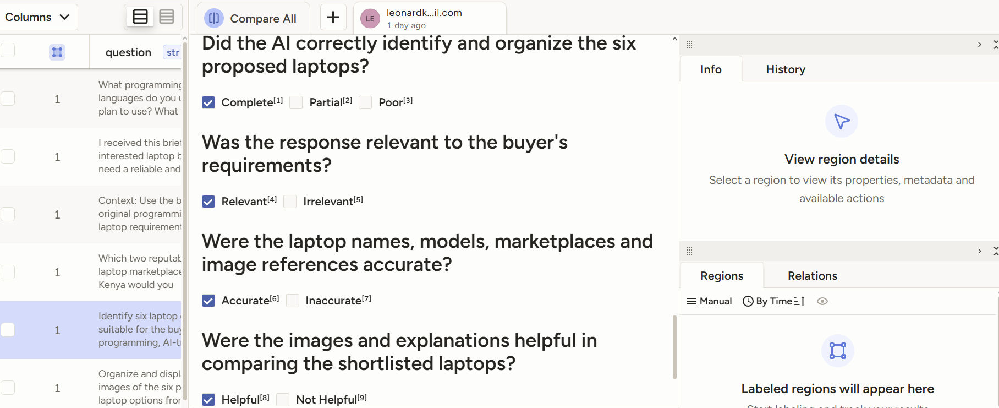

### Evaluation Findings

The AI successfully identified six laptop options from Jumia Kenya and Kilimall Kenya, with all advertised prices falling within the buyer's KSh 60,000 budget.

It provided the model names, advertised hardware specifications, prices and direct product links. This made it easier to compare the available options and investigate their suitability for programming workloads.

The response also demonstrated good evaluation awareness by distinguishing seller-advertised specifications from independently verified information.

**Areas for improvement:**

The AI could provide a more structured comparison of processor generations, core counts, RAM upgradeability and storage capacity. It should also verify whether the advertised configurations are accurate and whether the products are currently available before recommending them.

## 5. Task Outcome

The task successfully identified six laptop options from two online marketplaces, all within the buyer's budget.

The evaluation demonstrated that AI can assist with product research and organizing purchasing options. However, advertised specifications, current availability, seller credibility and warranty conditions still require independent verification before a final purchasing decision.

# Task 6: Keep Images of the Proposed Laptop Options

## Task Objective

Organize and display images of the six proposed laptop options from Jumia Kenya and Kilimall Kenya. Identify each laptop by its manufacturer, exact model and marketplace. Explain how product images support visual comparison before making a final purchasing decision.

## 1. Prompt and AI Response

The AI was instructed to organize the six proposed laptop options and explain how their images could help compare the shortlisted products.

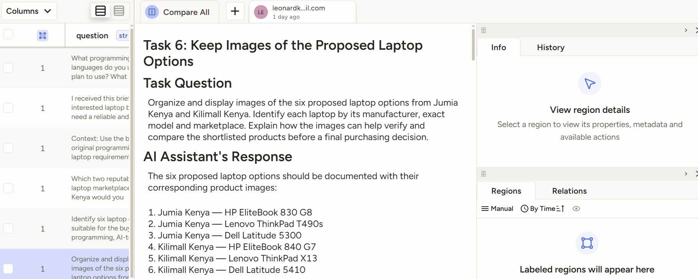

## 2. Images of the Six Proposed Laptop Options

The AI identified the following laptops and their respective marketplaces.

### Jumia Kenya

**HP EliteBook 830 G8**

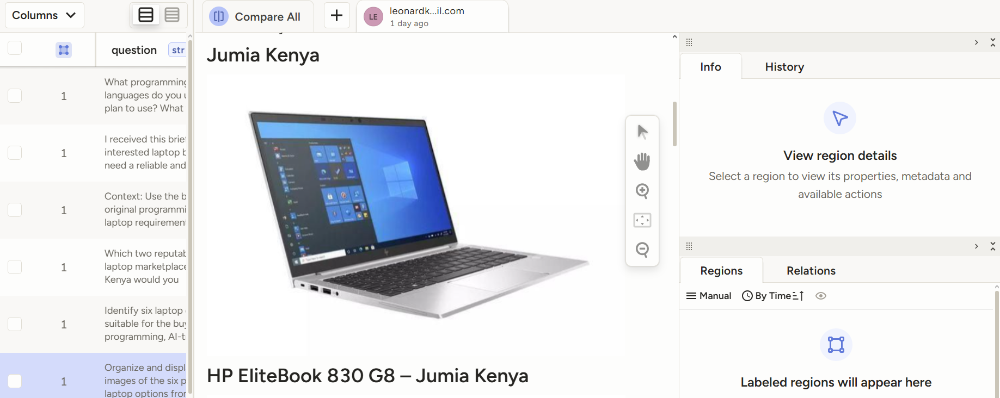

**Lenovo ThinkPad T490s**

**Dell Latitude 5300**

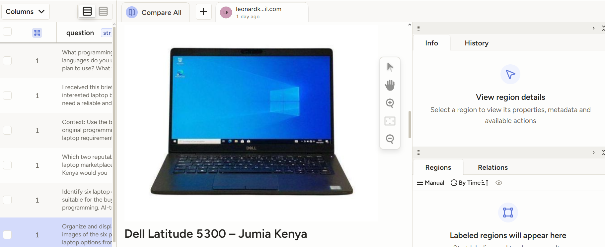

### Kilimall Kenya

**HP EliteBook 840 G7**

**Lenovo ThinkPad X13**

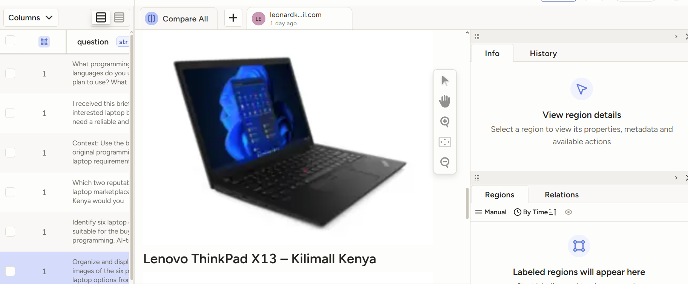

**Dell Latitude 5410**

## 3. Human Evaluation and Feedback

The AI correctly identified all six shortlisted laptops, their manufacturers, exact models and respective marketplaces. It also incorporated the product images and explained how they support visual comparisons.

The response correctly acknowledged that photographs cannot independently verify internal hardware specifications, battery health or the actual condition of the laptop being sold.

**Area for improvement:** The AI should provide a more detailed visual comparison of the six laptops and identify any differences between the displayed images and the sellers' advertised product descriptions.

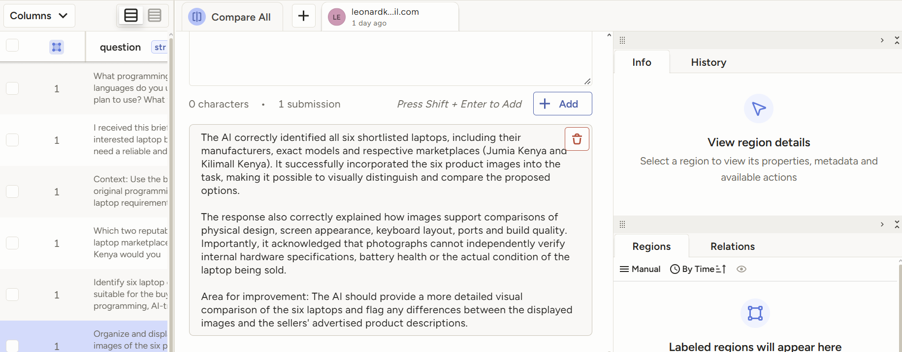

# Task 7: Find Out Whether the Processor Can Handle the Workload

## 1. Prompt

The AI was asked to assess whether the Intel Core i7-1165G7 processor could support the buyer's programming, software development and machine-learning requirements.

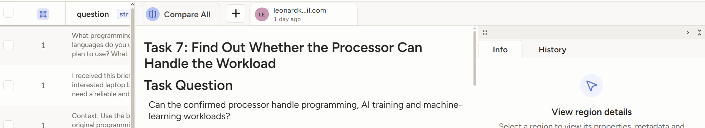

## 2. AI-Generated Response

### Processor Specifications

The AI identified the following specifications for the Intel Core i7-1165G7:

- 11th Generation Intel Core processor
- 4 cores and 8 threads
- Base clock speed: 2.8 GHz
- Maximum turbo frequency: 4.7 GHz
- Cache: 12 MB

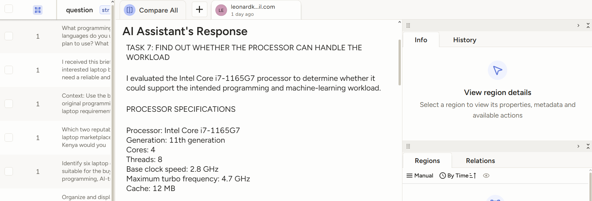

### Processor Performance Analysis

The AI explained that the processor can support everyday programming activities, including writing and testing code, running development environments, compiling smaller projects, browsing and moderate multitasking.

However, it highlighted limitations when handling demanding AI and machine-learning workloads, including large datasets, complex models and intensive local model training.

### Final Assessment

The AI concluded that the processor is suitable for general programming, software development and introductory machine-learning activities. It can also support lighter AI development using lightweight models and cloud-based computing resources.

For intensive local AI model training, the AI recommended considering adequate RAM, fast SSD storage and suitable graphics processing alongside the CPU.

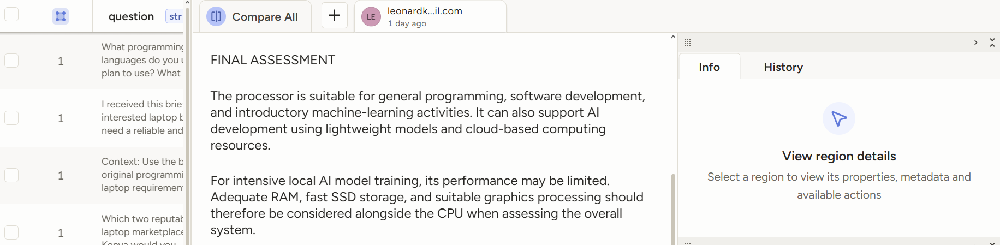

## 3. Human Evaluation and Feedback

The AI correctly explained the processor's capabilities and limitations in relation to the buyer's intended workload.

However, the evaluation identified an important weakness: the AI's assessment did not clearly establish whether laptops with Core i5 processors should also be eliminated or retained for further consideration.

The evaluation also highlighted the need to distinguish processor performance from the overall suitability of each laptop.

# Task 8: Insist on Upgradeable RAM

## 1. Prompt

The AI was asked to compare the installed RAM, RAM type, speed, available memory slots and upgradeability of the three shortlisted laptops, and identify the unsuitable option.

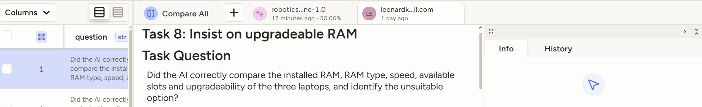

## 2. AI-Generated Response

### RAM Specifications Comparison

The AI compared the three laptops against the client's requirement for at least 16GB of RAM and the ability to upgrade memory when needed.

| Laptop | Dealer | Installed RAM | RAM Type and Speed | RAM Slots | Maximum RAM | Upgradeable |
|---|---|---:|---|---:|---:|---|
| HP EliteBook 830 G8 | Jumia | 16GB | DDR4-3200 | 2 SODIMM | Up to 64GB | Yes |
| Dell Latitude 5300 | Jumia | 16GB | LPDDR4x-4266 | Soldered | 16GB | No |
| Lenovo ThinkPad X13 Gen 2 | Kilimall | 16GB | DDR4-2666 | 2 SODIMM | Up to 32GB | Yes |

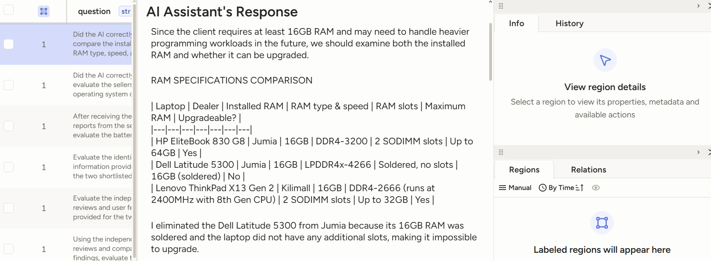

### Unsuitable Laptop Identified

The AI eliminated the Dell Latitude 5300 because its 16GB LPDDR4x memory is soldered onto the motherboard and has no additional RAM slots. This means the memory cannot be upgraded.

The HP EliteBook 830 G8 and Lenovo ThinkPad X13 Gen 2 were retained because their memory configurations were identified as upgradeable.

### Images of the Retained Laptops

**HP EliteBook 830 G8 – Jumia Kenya**

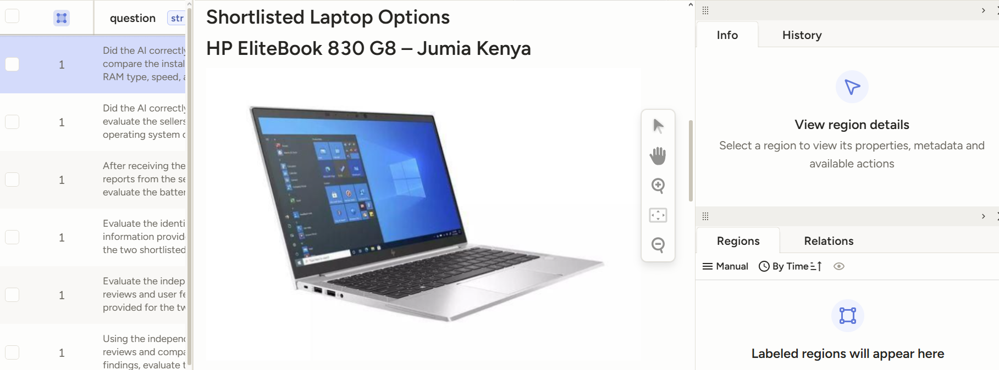

**Lenovo ThinkPad X13 Gen 2 – Kilimall Kenya**

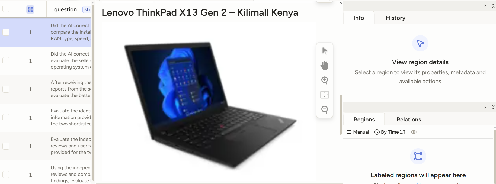

## 3. Human Evaluation and Feedback

The AI correctly understood the client's requirement for at least 16GB of RAM and compared all three laptops based on their memory specifications and upgradeability.

It correctly identified the Dell Latitude 5300 as unsuitable because its RAM is soldered and cannot be upgraded. It also retained the images of the two shortlisted laptops after eliminating the Dell.

**Area for improvement:** The AI should have provided an update on the shortlisted laptops and ensured that the RAM specifications and upgrade limits were verified against the exact laptop configurations.

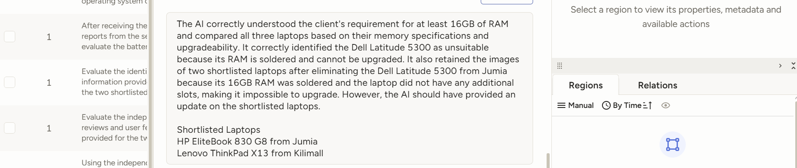

# Task 9: Operating System Verification

## 1. Prompt

The AI was asked to evaluate the sellers' operating system claims, interpret the Windows verification results, distinguish Windows activation from ongoing Microsoft support, and identify which laptop meets the client's operating system requirements.

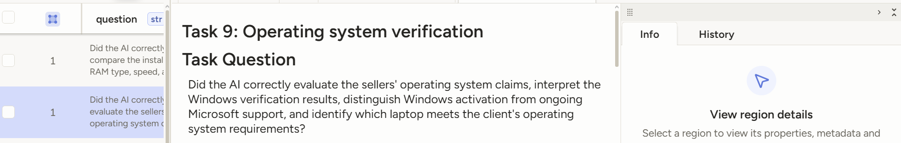

## 2. AI-Generated Response

### Requesting Operating System Verification

Rather than relying on sellers' verbal confirmations that the laptops had Windows 11, the AI prepared instructions requesting screenshots of the Windows specifications.

The sellers were asked to navigate to This PC, open Properties and provide a clear screenshot showing the Windows edition, version and OS build.

The buyer preferred Windows 11 because standard Windows 10 support ended on 14 October 2025.

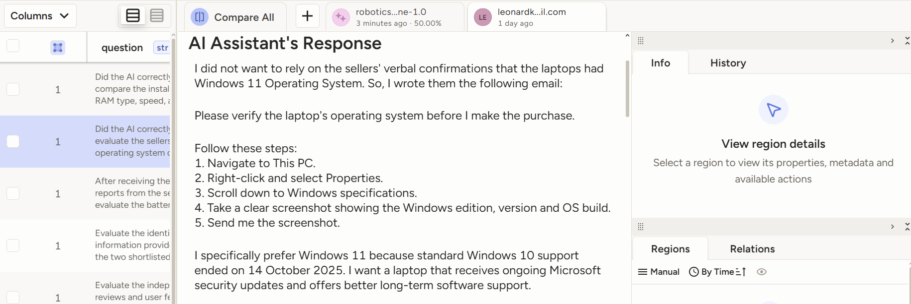

### Operating System Verification Results

The AI compared the information received from the two sellers.

**HP EliteBook 830 G8 – Jumia**

| Specification | Preferred Requirement | Verified Result |
|---|---|---|
| Edition | Windows 11 Pro or Home | Windows 11 Pro |
| Version | Windows 11 24H2 or newer | Windows 11 24H2 |
| OS Build | Currently supported build | 26100.7171 |
| Activation | Windows activated | Activated |

**Lenovo ThinkPad X13 Gen 2 – Kilimall**

| Specification | Preferred Requirement | Verified Result |
|---|---|---|
| Edition | Windows 11 Pro or Home | Windows 10 Pro |
| Version | Windows 11 24H2 or newer | Windows 10 22H2 |
| OS Build | Currently supported build | 19045.6456 |
| Activation | Windows activated | Activated |

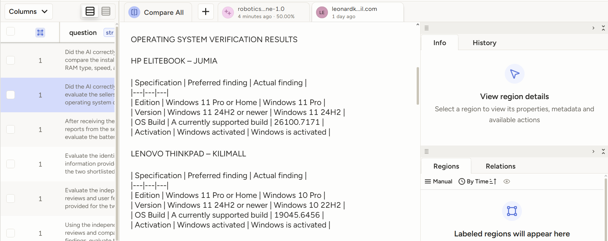

### Comparative Analysis and Recommendation

The AI concluded that the HP EliteBook 830 G8 was the stronger option for operating system compatibility because it already had Windows 11 Pro installed.

The Lenovo ThinkPad X13 Gen 2 had activated Windows 10 Pro. However, activation does not mean that Microsoft continues to provide standard support and security updates for that Windows version.

The AI therefore recommended the HP EliteBook because it met the Windows 11 requirement without requiring an operating system upgrade.

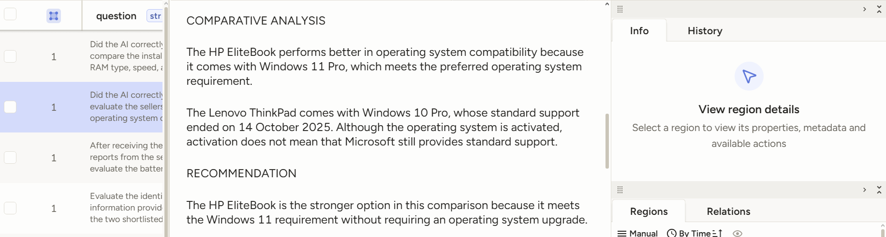

## 3. Human Evaluation and Feedback

The AI correctly understood the operating system verification requirements and compared the Windows specifications of the HP EliteBook 830 G8 and Lenovo ThinkPad X13 Gen 2.

It correctly distinguished Windows activation from ongoing Microsoft support and identified the HP as the stronger option for the preferred operating system requirement.

The AI also retained both shortlisted laptops for further evaluation rather than eliminating the Lenovo solely because it had Windows 10. Other factors, including customer reviews and warranties, still needed consideration before making the final purchasing decision.

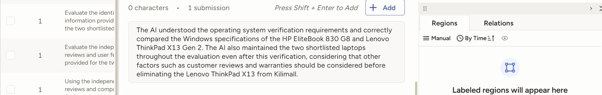

# Task 10: Battery Health Report Evaluation

## 1. Prompt

After receiving battery reports from the sellers, the AI was asked to evaluate the battery condition of the two shortlisted laptops. The comparison covered design capacity, full charge capacity, battery health, battery wear and charge cycle count.

The objective was to identify which laptop had the healthier battery and provide a recommendation supported by the reported figures.

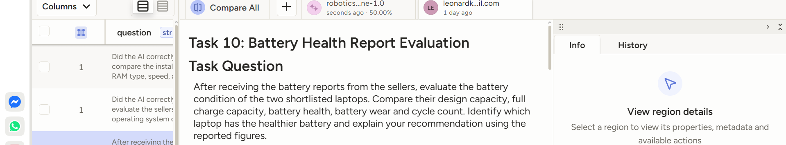

## 2. AI-Generated Response

### Battery Specifications Comparison

The AI compared the battery reports for:

1. HP EliteBook 830 G8 – Jumia Kenya
2. Lenovo ThinkPad X13 Gen 2 – Kilimall Kenya

| Battery Specification | HP EliteBook 830 G8 | Lenovo ThinkPad X13 Gen 2 |
|---|---:|---:|
| Design Capacity | 53,010 mWh | 54,700 mWh |
| Full Charge Capacity | 46,649 mWh | 44,854 mWh |
| Battery Health | 88% | 82% |
| Battery Wear | 12% | 18% |
| Charge Cycle Count | 240 | 360 |

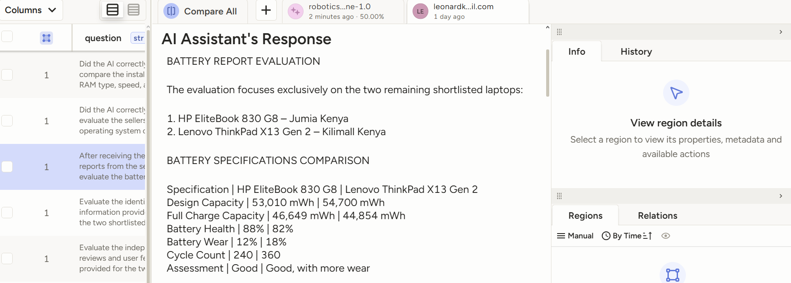

### Analysis of Battery Results

The AI identified several differences:

- **Battery health:** The HP retained 88% of its original capacity, compared with 82% for the Lenovo.
- **Battery wear:** The HP had 12% wear, while the Lenovo had 18%.
- **Full charge capacity:** The HP could hold 46,649 mWh, compared with 44,854 mWh for the Lenovo.
- **Charge cycles:** The HP had 240 cycles, compared with 360 for the Lenovo.

These figures indicated that the HP battery had retained more of its original capacity and experienced less deterioration.

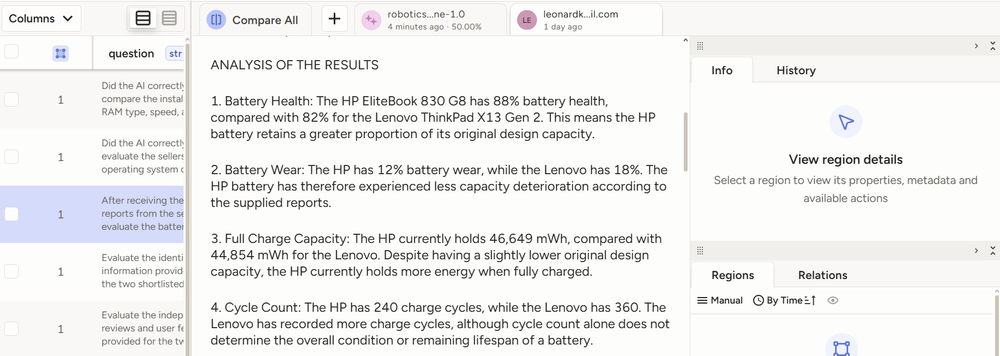

### Final Recommendation

The AI recommended the HP EliteBook 830 G8 because its battery had better reported health, lower wear, higher full charge capacity and fewer recorded charge cycles.

The Lenovo ThinkPad X13 Gen 2 remained a viable option, but its battery showed greater wear and lower remaining capacity.

The AI also advised considering actual battery runtime, battery age, replacement cost and warranty before making the final purchase decision.

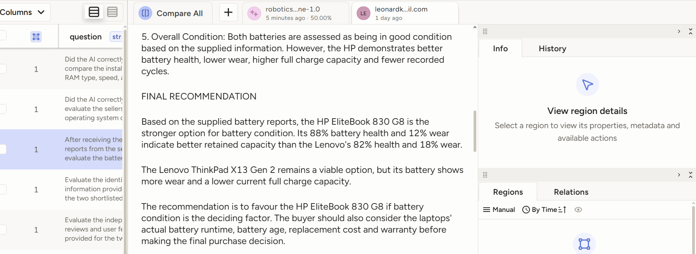

## 3. Human Evaluation and Feedback

The AI correctly interpreted and compared the battery reports submitted by the sellers. It accurately assessed both laptops using design capacity, full charge capacity, battery health, battery wear and charge cycle count.

It correctly established that the HP had better battery condition, with 88% health, 12% wear and 240 charge cycles, compared with the Lenovo's 82% health, 18% wear and 360 charge cycles.

The evaluation also confirmed that the AI maintained the updated shortlist of only two laptops and did not reintroduce previously eliminated options.

**Area for improvement:** Actual battery runtime and battery age would provide additional information before making the final purchase decision.

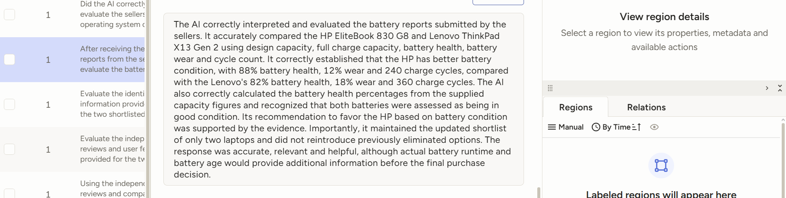

# Task 11: Check the Model Number Against the Manufacturer's Website

## 1. Prompt

The AI was asked to evaluate the identification information provided for the two shortlisted laptops and explain how their product numbers and machine type model (MTM) numbers could be used to verify the exact laptop models and configurations through official manufacturer support websites.

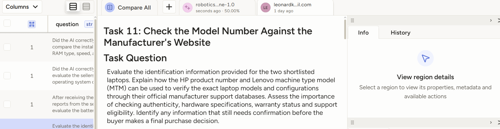

## 2. AI-Generated Response

### Manufacturer Model and Identification Details

The AI focused on the two remaining shortlisted laptops:

1. HP EliteBook 830 G8 – Jumia Kenya
2. Lenovo ThinkPad X13 Gen 2 – Kilimall Kenya

It identified the following details from the information provided.

**HP EliteBook 830 G8**

- Manufacturer: HP
- Model: EliteBook 830 G8
- Product Number: 5G2X8EA
- Serial Number: 5CD1234X9Z

**Lenovo ThinkPad X13 Gen 2**

- Manufacturer: Lenovo
- Model: ThinkPad X13 Gen 2
- Machine Type Model (MTM): 20W8-CTO1WW
- Serial Number: PF-3A7K9M2

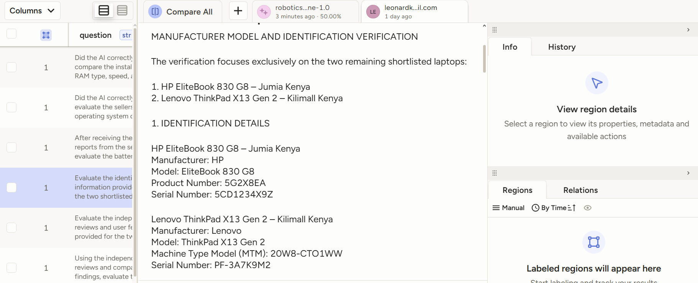

### How to Verify the Identifiers

The AI explained how to use the official manufacturer support websites to check each laptop.

**HP verification**

The HP product number and serial number can be entered into the official HP support website to retrieve product information associated with the device.

Official website: https://support.hp.com/

**Lenovo verification**

The Lenovo MTM and serial number can be entered into Lenovo Support to identify the exact machine and retrieve its product specifications, support information and warranty details.

Official website: https://support.lenovo.com/

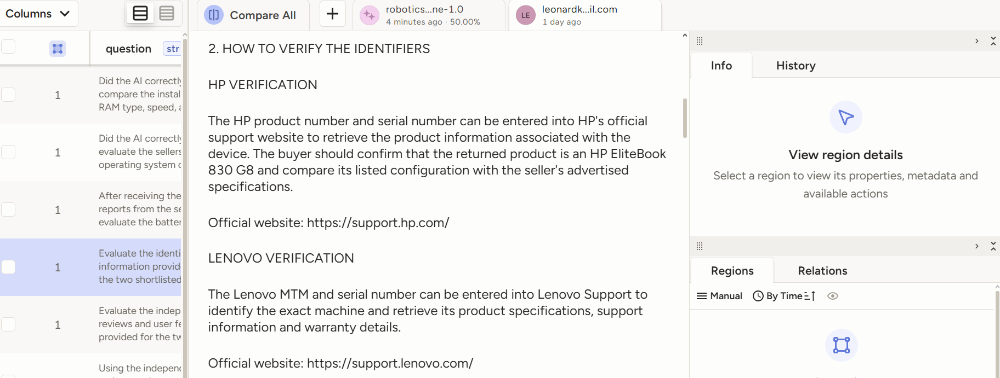

### Why Manufacturer Verification Matters

The AI identified several reasons for checking the identifiers directly with the manufacturers:

- **Authenticity verification:** Manufacturer records can help establish whether the identifiers correspond to a recognised product.
- **Accurate identification:** Product numbers and MTM details help identify the exact model and configuration.
- **Warranty verification:** Manufacturer support records can help establish warranty coverage and service eligibility.
- **Technical support:** Correct identification helps technicians provide model-specific troubleshooting guidance.
- **Parts compatibility:** Exact model identification helps determine compatible replacement batteries, keyboards, screens and chargers.
- **Product history:** Available manufacturer records may provide registration, service or warranty information.

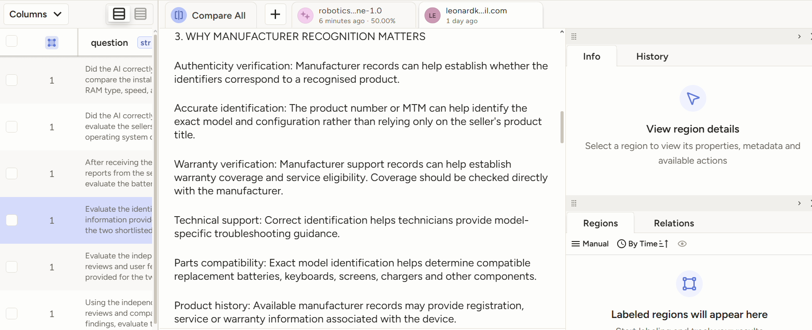

## 3. Human Evaluation and Feedback

The AI correctly understood the importance of verifying the exact laptop models using manufacturer identification numbers.

It correctly distinguished the HP product number from the Lenovo MTM and explained how these identifiers could be used to retrieve manufacturer records.

The response appropriately discussed authenticity, warranty coverage, technical support and parts compatibility.

**Area for improvement:** The AI explained the verification process but did not provide actual manufacturer lookup results. The identifiers still needed to be checked directly on the official support websites before drawing conclusions about authenticity, configuration and warranty status.

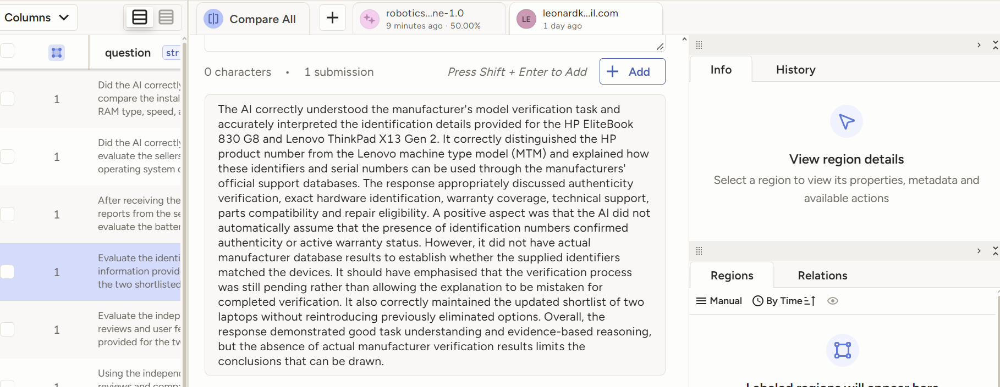

# Task 13: Reading Reliable Reviews

## 1. Task Objective

Evaluate independent reviews and user feedback for the two shortlisted laptops: **HP EliteBook 830 G8** and **Lenovo ThinkPad X13 Gen 2**.

The assessment considers their suitability for programming, software compilation, large file transfers, multitasking, large datasets, Docker containers, virtual machines, sustained workloads and AI/ML activities.

The aim is to distinguish controlled benchmark results from individual user experiences, assess the reliability and limitations of the available evidence, and determine which laptop appears more suitable for the buyer's requirements.

## 2. Prompt

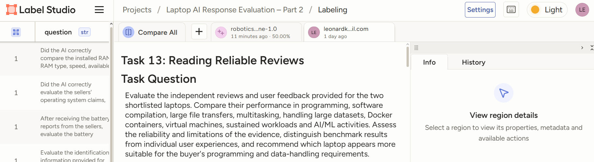

## 3. AI-Generated Response

### HP EliteBook 830 G8

The AI reviewed Notebookcheck benchmark results for an HP EliteBook 830 G8 configuration featuring an Intel Core i7-1165G7 processor and NVMe SSD.

The reported sequential SSD performance was approximately:

- Read speed: 2,456 MB/s
- Write speed: 2,032 MB/s

The review also provided evidence about programming responsiveness, application performance and everyday multitasking.

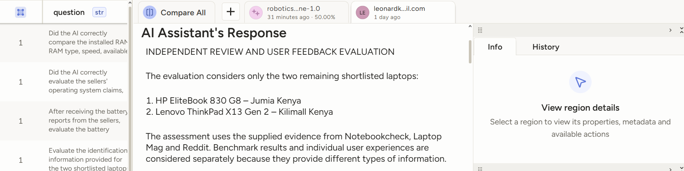

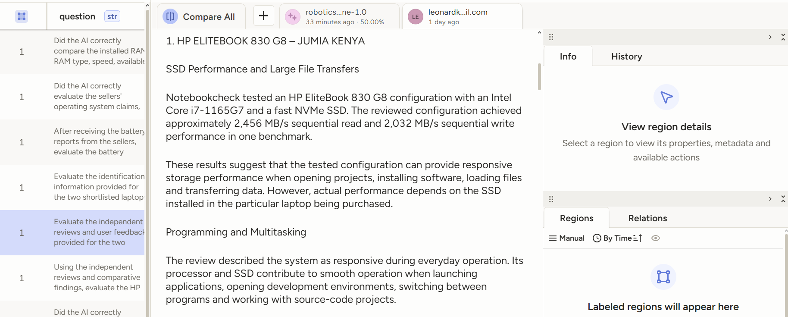

### Lenovo ThinkPad X13 Gen 2

The AI examined Laptop Mag's file-transfer test, in which the reviewed ThinkPad X13 Gen 2 configuration copied 25GB of multimedia files in approximately 1 minute and 26 seconds, achieving around 310.5 MB/s.

The response recognised that this was useful benchmark evidence but cautioned against directly comparing it with the HP's sequential SSD results because the tests used different methods and workloads.

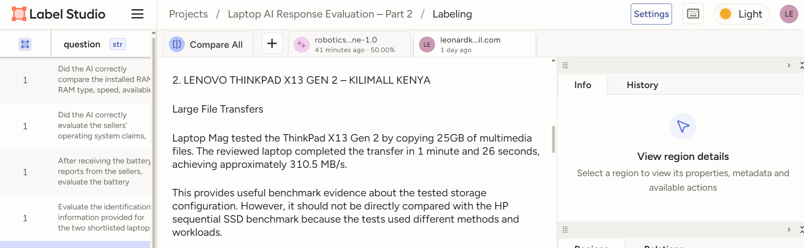

### Sustained Workloads and Cooling

The AI considered thermal behaviour under sustained CPU and GPU workloads. It identified potential performance and cooling limitations during prolonged demanding tasks, including extended compilations, multiple Docker containers and data-processing workloads.

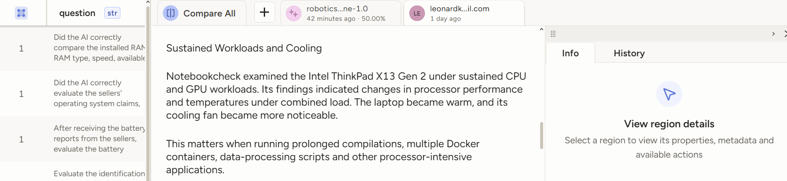

### Comparative Findings

The AI compared the available evidence across several areas:

- **Large file transfers:** Both laptops demonstrated storage performance, but the different testing methods prevented a direct numerical comparison.
- **Programming and compilation:** Both appeared suitable for ordinary programming, with different types of benchmark and user-feedback evidence.
- **IDEs and multitasking:** Both could support development environments and everyday multitasking, depending on processor configuration, RAM and storage.
- **Large datasets:** Storage speed helps with loading and saving data, while RAM and processor performance also affect handling larger datasets.

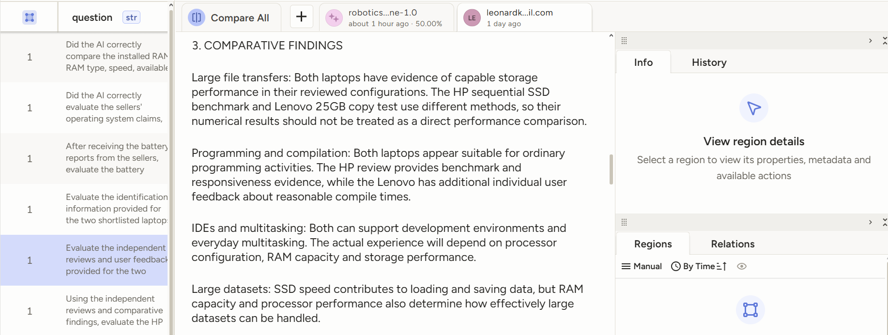

### Docker, Virtual Machines and AI/ML

The AI explained that both laptops could support development workloads involving Docker and virtual machines, but running several containers or larger virtual machines simultaneously could place considerable demands on available RAM and CPU resources.

It also cautioned that integrated graphics should not be confused with a dedicated high-performance GPU. Both systems may support programming, data preparation and lightweight machine-learning experiments, but should not automatically be considered suitable for demanding local model training.

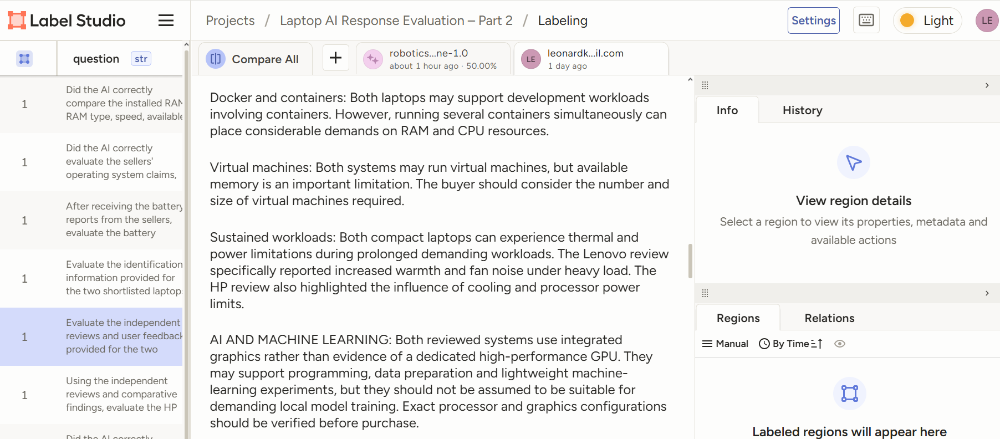

### Reliability and Limitations of Review Evidence

The AI distinguished between controlled testing from Notebookcheck and Laptop Mag and individual experiences shared on Reddit.

It recognised that:

- Benchmark results apply to the specific configurations tested.
- Individual user reports provide useful practical experiences but are not controlled benchmarks.
- Different storage tests should not be treated as directly comparable.
- Actual processor, SSD, RAM and graphics configurations must be verified before relying on review findings.

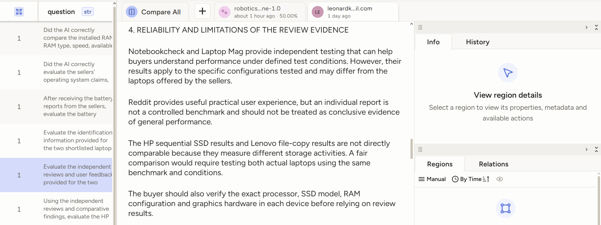

### Final Assessment and Recommendation

The AI concluded that both laptops could support general programming, development tools, everyday multitasking and moderate data-handling activities.

The HP EliteBook 830 G8 appeared attractive because of its reviewed SSD performance and RAM upgrade potential. The Lenovo ThinkPad X13 Gen 2 remained a viable option based on its file-transfer benchmark and positive individual programming feedback.

However, the available evidence was not sufficient to declare either laptop the clear overall performance winner.

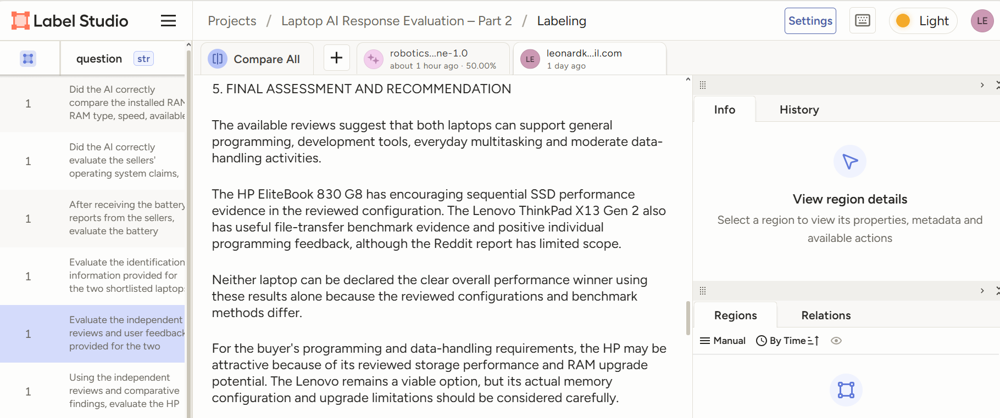

## 4. Human Evaluation of the AI Response

The evaluation found that the AI correctly understood the task and compared the available evidence across the two shortlisted laptops.

**Strengths identified:**

- Distinguished controlled benchmark results from individual user experiences.
- Correctly recognised that the HP sequential SSD benchmark and Lenovo file-copy test used different methods.
- Discussed processor performance, RAM capacity, storage and thermal limitations.
- Considered programming, multitasking, Docker, virtual machines and AI/ML workloads.
- Avoided declaring an unsupported overall performance winner.

**Limitation identified:**

The response relied on supplied review summaries without independently confirming that the tested hardware configurations matched the actual laptops offered by the sellers. Stronger verification of the configurations would improve factual reliability.

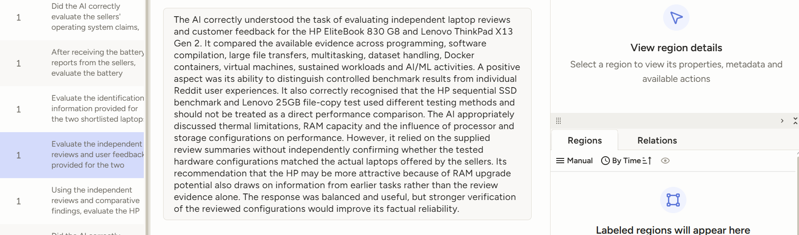

# Task 14: Comparative Review Analysis

## 1. Task Objective

Evaluate independent reviews and comparative findings for the **HP EliteBook 830 G8** and **Lenovo ThinkPad X13 Gen 2**.

The assessment focuses on processor performance, programming suitability, file-transfer performance, cooling, thermal behaviour and sustained workloads.

The objective is to determine what the available review evidence reveals about each laptop's suitability for programming, software development, multitasking, large datasets, Docker containers and virtual machines, while identifying limitations in the benchmark comparisons.

## 2. Prompt

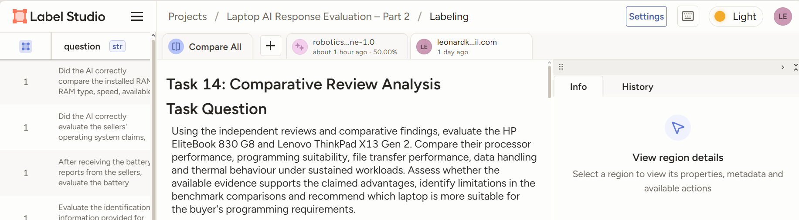

## 3. AI-Generated Comparative Analysis

### 3.1 Processor and Programming Performance

The AI compared the processor specifications supplied for both laptops. The configurations were reported as featuring Intel Core i7-1165G7 processors, with four cores and eight threads.

Based on these specifications, both laptops appeared suitable for general programming, integrated development environments, compiling code and everyday multitasking.

However, the AI correctly noted that processor specifications alone do not establish which laptop performs better. Actual performance also depends on cooling, power limits, memory configuration and the condition of each device.

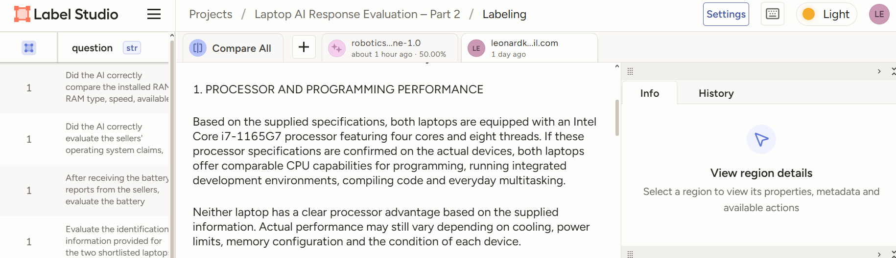

### 3.2 File Transfer and Storage Performance

The AI examined two independent benchmark results:

**HP EliteBook 830 G8**

Notebookcheck reported approximately:
- Sequential SSD read speed: 2,456 MB/s
- Sequential SSD write speed: 2,032 MB/s

**Lenovo ThinkPad X13 Gen 2**

Laptop Mag reported that its tested configuration transferred 25GB of multimedia files in approximately 1 minute and 26 seconds, achieving around 310.5 MB/s.

The AI recognised that these results came from different testing methods. Sequential SSD benchmarks and real-world file-copy tests cannot be directly compared to declare one laptop faster.

### 3.3 Heat Management and Thermal Performance

The AI examined the thermal limitations identified in the independent reviews.

For the HP, the supplied review indicated that processor power limits and cooling could influence performance during prolonged demanding workloads.

For the Lenovo, the review reported increased warmth and more noticeable fan noise under sustained CPU and GPU workloads.

The AI concluded that both laptops have thermal limitations that should be considered when running prolonged compilations, virtual machines, containers and data-processing applications.

### 3.4 Sustained Workloads and Data Handling

The AI considered how both laptops could handle:

- Programming and software compilation
- Multitasking and moderate data processing
- Large datasets and file transfers
- Docker containers and virtual machines

It explained that sustained performance depends on processor power limits, cooling capacity, available RAM and SSD performance.

The buyer should also consider memory capacity carefully because multiple development tools, containers and virtual machines can consume substantial RAM.

### 3.5 Comparative Summary

The AI summarised the available evidence as follows:

| Evaluation Area | Comparative Finding |
|---|---|
| Processor | Both were reported with Intel Core i7-1165G7 specifications, subject to verification |
| Programming | Both appear suitable for general programming and ordinary development tasks |
| File transfer | HP had encouraging sequential SSD results; Lenovo had a real-world file-copy benchmark |
| Thermal performance | Both have potential cooling and power limitations |
| Sustained workloads | Neither can be declared the clear winner from the supplied evidence |

The AI avoided treating different benchmark methods as directly comparable and did not make an unsupported claim that one laptop was universally faster.

### 3.6 Final Recommendation

The AI considered the HP EliteBook 830 G8 a promising option for data-intensive file operations because of its reported sequential SSD performance.

However, it did not declare the HP the overall performance winner. The Lenovo remained a competitive option because of its real-world file-transfer evidence and programming suitability.

Before making a final purchase decision, the buyer should verify the actual processor, RAM, SSD and cooling condition of the specific units being offered. The Lenovo processor specification also requires confirmation against manufacturer records.

## 4. Human Evaluation of the AI Response

The human evaluation found that the AI correctly understood the task and provided a relevant comparison of the two shortlisted laptops.

**Strengths identified:**

- Correctly interpreted the supplied processor specifications.
- Distinguished sequential SSD benchmarks from real-world file-transfer tests.
- Recognised that the different testing methods do not support a direct performance comparison.
- Discussed thermal limitations and sustained workload performance.
- Considered the buyer's programming and development requirements.
- Avoided declaring an unsupported overall winner.

**Limitation identified:**

The Lenovo processor specification still needed confirmation against manufacturer records. Verifying the exact hardware configuration of each seller's unit would strengthen the comparison.

The response was evaluated as accurate, relevant and helpful, with appropriate caution about the limitations of the available evidence.

# Task 15: Warranties and Return Policies

## 1. Task Prompt

The AI was asked to compare the warranty periods, battery coverage and return policies offered by Jumia Kenya and Kilimall Kenya for the two shortlisted laptops. The objective was to determine which laptop offered better buyer protection.

## 2. AI-Generated Response

### HP EliteBook 830 G8 – Jumia Kenya

- **Seller warranty:** 6 months.
- **Hardware coverage:** Major components, including the motherboard, RAM and SSD.
- **Battery coverage:** 1 month.
- **Return window:** 7 days from delivery for defective products or products significantly different from the advertised specifications.
- **Remedy:** Replacement or refund after confirmation of the defect or discrepancy.

### Lenovo ThinkPad X13 Gen 2 – Kilimall Kenya

- **Seller warranty:** 3 months.
- **Hardware coverage:** Hardware defects.
- **Battery coverage:** 14 days.
- **Return window:** 7 days from delivery for defective products or products that do not match the advertised description.
- **Remedy:** Replacement or refund, subject to inspection and approval.

## 3. Comparative Assessment

The AI identified that the HP EliteBook 830 G8 offers more favourable seller-provided warranty terms:

- Its six-month hardware warranty is twice as long as Lenovo's three-month warranty.
- Its one-month battery coverage is longer than Lenovo's 14-day coverage.
- Both sellers provide a seven-day return window, subject to their stated conditions and inspection procedures.

The AI also advised requesting written confirmation of warranty coverage, exclusions, repair procedures, return conditions and seller identity before making payment. It correctly distinguished seller warranties from manufacturer warranties.

## 4. AI's Final Assessment

Based on the information supplied by the sellers, the AI recommended the **HP EliteBook 830 G8 from Jumia Kenya** because it offers longer hardware warranty coverage and longer battery protection.

The recommendation was conditional on the seller confirming the stated terms in writing before payment. The AI also clarified that the seller-provided information had not been independently verified.

## 5. Human Evaluation and Feedback

The AI response was evaluated as **Relevant, Accurate and Helpful**.

The evaluation confirmed that the AI:

- Correctly compared the six-month HP warranty with Lenovo's three-month warranty.
- Identified the difference in battery coverage: one month for HP and 14 days for Lenovo.
- Recognised that both sellers offered a seven-day return period.
- Provided practical buyer-protection advice.
- Distinguished seller warranties from manufacturer warranties.
- Reached a conclusion supported by the information supplied.

An important limitation is that the warranty information came from seller-provided responses and was not independently verified. Written confirmation should therefore be obtained before purchase.

# Task 16: Professional Recommendation

## 1. Task Prompt

Based on the research and evaluation completed, the AI was asked to determine whether the HP EliteBook 830 G8 should be selected as the final laptop for the buyer's programming requirements and whether the recommendation was supported by the available evidence.

## 2. AI-Generated Professional Recommendation

The AI recommended the **HP EliteBook 830 G8 from Jumia Kenya** after considering its processing performance, storage, RAM upgradeability, operating system, battery condition, professional reviews and seller warranty.

### Key Evaluation Findings

**Processing Performance**

The laptop has an 11th-generation Intel Core i7 processor, considered suitable for programming activities such as running development environments, compiling code and managing everyday development workloads.

**Storage Performance**

The professional review supplied for the HP configuration reported sequential SSD speeds of approximately 2,456 MB/s read and 2,032 MB/s write. The AI noted that the actual SSD performance of the seller's unit still needed confirmation.

**RAM Upgradeability**

The HP EliteBook 830 G8 was identified as supporting up to 64GB of RAM, subject to the exact configuration and compatible memory modules. The AI considered this useful for multitasking, programming and running virtual machines. The actual memory configuration needed verification.

**Operating System**

The supplied system information identified the laptop as running Windows 11 Pro, version 24H2. The AI cautioned that this version reached its end of support on 13 October 2026 and recommended updating to a currently supported Windows 11 release.

**Battery Condition**

The supplied battery report showed:

- Design capacity: 53,010 mWh
- Full-charge capacity: 46,649 mWh
- Battery health: Approximately 88%
- Battery wear: Approximately 12%

The AI considered this a reasonably good battery condition based on the report, while recommending verification against the actual device.

**Warranty and Seller Protection**

The Jumia seller stated that the laptop comes with:

- Six-month warranty covering major hardware components.
- One-month battery coverage.
- Seven-day return period for defective products, subject to inspection.

The AI advised obtaining written confirmation of these terms before payment.

**Thermal Performance**

The AI recognised potential processor power and cooling limitations during prolonged demanding workloads. It recommended inspecting the laptop and checking temperatures and fan behaviour under load where possible.

## 3. Final Decision

The AI selected the **HP EliteBook 830 G8 – Jumia Kenya** as the final recommendation.

The decision was based on its processing capability, reported SSD performance, RAM upgrade potential, supplied battery-health results, Windows 11 installation and favourable seller warranty terms.

Before payment, the buyer was advised to confirm the exact processor, RAM configuration and upgrade compatibility, SSD, supported Windows 11 updates, battery condition and written seller warranty.

## 4. Recommended Laptop

**HP EliteBook 830 G8 – Jumia Kenya**

## 5. Human Evaluation Criteria

The final recommendation was evaluated against four criteria:

- **Task Understanding:** Complete
- **Relevance:** Relevant
- **Accuracy:** Accurate
- **Helpfulness:** Helpful

The evaluation considered whether the AI understood the buyer's programming requirements, used relevant specifications and supporting evidence, and provided a useful final purchase recommendation.

## 6. Human Evaluation and Feedback

The AI correctly understood the task as a final professional recommendation and selected the HP EliteBook 830 G8 for the buyer's programming requirements.

The response brought together evidence from the earlier tasks, including processing capability, SSD performance, RAM upgradeability, battery health, operating system, professional reviews and warranty coverage.

The human evaluation identified several limitations:

- The SSD benchmark and professional review findings related to reviewed configurations and did not independently establish the performance of the exact seller's unit.
- RAM capacity and upgradeability required confirmation on the actual laptop.
- Battery condition also needed verification against the physical device.
- The AI should have stated the final laptop price, which had dropped from KSh 50,000 to **KSh 49,000** during the Black Friday offer.

Overall, the recommendation was considered reasonable and supported by the accumulated evidence, subject to the final checks before purchase.

## 7. Skills Demonstrated

- AI response evaluation and quality assurance
- Evidence-based decision-making
- Comparing technical specifications
- Analysing professional reviews and benchmark results
- Evaluating operating system and battery information
- Assessing warranty and seller protection
- Identifying unsupported claims and evidence limitations
- Providing a justified professional recommendation
