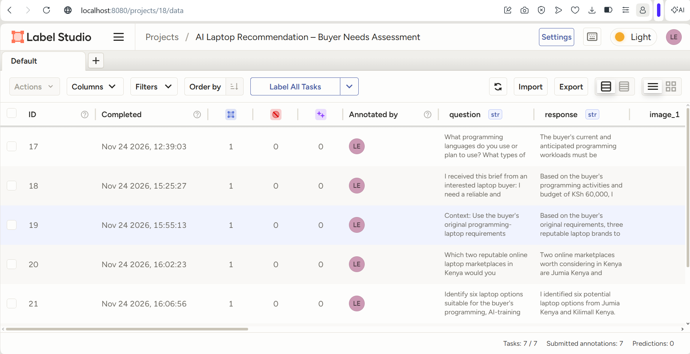
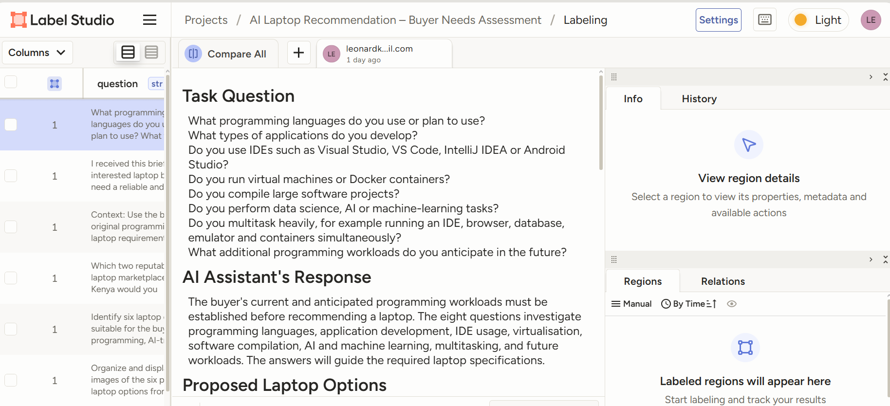

# AI Laptop Purchase Project

## Project Overview

This project documents a practical laptop purchasing exercise supported by an AI assistant. It examines how AI can help identify buyer requirements, research available laptops, compare alternatives, assess purchasing risks, and develop a professional recommendation.

The project also evaluates the quality of AI-generated responses through human annotation and feedback using Label Studio.

### Project Overview Screenshot

## Project Objectives

- Evaluate AI-generated responses in a realistic laptop purchasing scenario.
- Assess response relevance, accuracy, and helpfulness.
- Identify missing information, errors, and weaknesses in AI responses.
- Compare AI-generated predictions with human evaluations.
- Document evaluation results and supporting evidence.

## Tools Used

- **ChatGPT:** AI response generation and assistance.
- **Label Studio:** Task annotation and human evaluation.
- **GitHub:** Project documentation and evidence storage.

## Task 1: Buyer Needs Assessment

### Objective

Establish the buyer's programming and computing requirements before recommending a suitable laptop.

### Prompt and AI Response

### Human Evaluation Feedback

### Human Evaluation Summary

| Evaluation Criterion | Human Assessment |
|---|---|
| Relevance | Relevant |
| Accuracy | Accurate |
| Helpfulness | Helpful |

The response correctly identified the eight areas that needed investigation, including programming languages, application development, IDE usage, virtualisation, software compilation, AI and machine learning, multitasking, and anticipated future workloads.

**Identified limitation:** The response explained what information needed to be collected but did not yet translate the questions into specific hardware requirements. The buyer's answers would be needed to establish suitable processor, memory, storage, and upgradeability requirements.

### Task 1 Outcome

The human evaluation confirmed that the AI response provided a relevant and useful starting point for understanding the buyer's needs. The next stage of the project can use this information to guide laptop selection.

---

## Project Evidence

Screenshots for each task will be added progressively as the project develops. Each task will include its prompt, AI-generated response, and human evaluation evidence where applicable.

## Skills Demonstrated

- AI response evaluation
- Human annotation and feedback
- Prompt analysis
- Relevance and accuracy assessment
- Critical thinking
- Identification of AI response limitations
- Technical documentation
