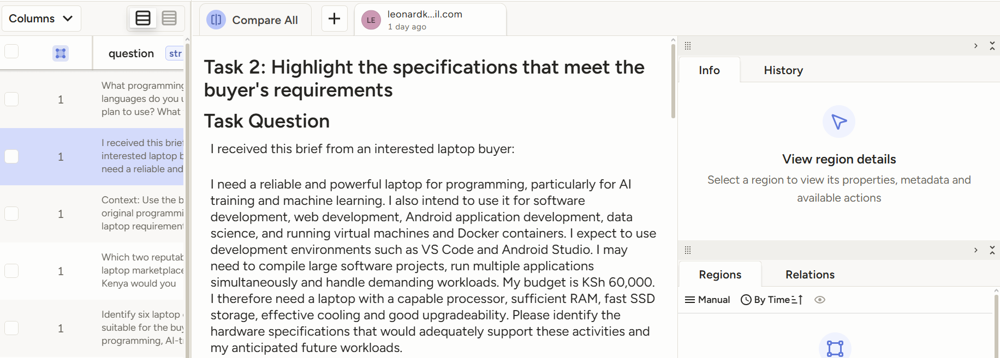
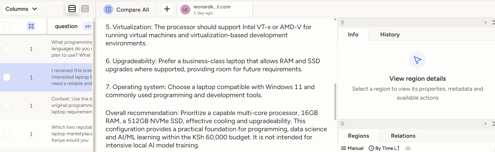

# AI Laptop Purchase Project

## Project Overview

This project documents a practical laptop purchasing exercise supported by an AI assistant. It examines how AI can help identify buyer requirements, research available laptops, compare alternatives, assess purchasing risks, and develop a professional recommendation.

The project also evaluates the quality of AI-generated responses through human annotation and feedback.

### Project Overview Screenshot

## Project Objectives

- Evaluate AI-generated responses in a realistic laptop purchasing scenario.
- Assess response relevance, accuracy, and helpfulness.
- Identify missing information, errors, and weaknesses in AI responses.
- Compare AI-generated predictions with human evaluations.
- Document evaluation results and supporting evidence.

## Task 1: Buyer Needs Assessment

### Objective

Establish the buyer's programming and computing requirements before recommending a suitable laptop.

### Prompt and AI Response

### Human Evaluation Feedback

The response correctly identified the eight areas that needed investigation, including programming languages, application development, IDE usage, virtualisation, software compilation, AI and machine learning, multitasking, and anticipated future workloads.

**Identified limitation:** The response explained what information needed to be collected but did not yet translate the questions into specific hardware requirements. The buyer's answers would be needed to establish suitable processor, memory, storage, and upgradeability requirements.

### Task 1 Outcome

The human evaluation confirmed that the AI response provided a relevant and useful starting point for understanding the buyer's needs. The information collected would guide the subsequent laptop selection process.

---

## Project Evidence

Screenshots for each task will be added progressively as the project develops. Each task will include its prompt, AI-generated response, and human evaluation evidence where applicable.

## Skills Demonstrated

- AI response evaluation
- Human annotation and feedback
- Prompt analysis
- Relevance and accuracy assessment
- Critical thinking
- Identification of AI response limitations
- Technical documentation

# AI Laptop Purchase Project

## Project Overview

This project documents a practical laptop purchasing exercise supported by an AI assistant. It examines how AI can help identify buyer requirements, research available laptops, compare alternatives, assess purchasing risks, and develop a professional recommendation.

The project also evaluates AI-generated responses through human annotation, critical review, and feedback.

### Project Overview Screenshot

## Project Objectives

- Evaluate AI-generated responses in a realistic laptop purchasing scenario.
- Assess response relevance, accuracy, and helpfulness.
- Identify missing information, errors, and weaknesses in AI responses.
- Compare AI-generated outputs with human evaluations.
- Document evaluation results and supporting evidence.

---

# Task 2: Highlight the Specifications That Meet the Buyer's Requirements

## Objective

Identify the hardware specifications required to support the buyer's programming activities, particularly AI training and machine learning, while considering the KSh 60,000 budget and anticipated future workloads.

## 1. Task Prompt

The buyer requires a reliable and powerful laptop for:

- AI training and machine learning
- Software development and web development
- Android application development
- Data science
- Virtual machines and Docker containers
- VS Code and Android Studio
- Compiling large software projects
- Running multiple applications simultaneously

The buyer also requires a capable processor, sufficient RAM, fast SSD storage, effective cooling, and good upgradeability.

## 2. AI-Generated Response

The AI translated the buyer's workload into the following recommended hardware specifications:

| Hardware Component | Recommended Specification |
|---|---|
| Processor | Intel Core i5 or i7, preferably 10th or 11th Generation, or comparable AMD Ryzen 5 |
| Processor Cores | At least 4 cores and 8 threads |
| RAM | Minimum 16GB DDR4, preferably upgradeable to 32GB or more |
| Storage | 512GB NVMe SSD |
| Cooling | Effective thermal management |
| Virtualisation | Intel VT-x or AMD-V support |
| Upgradeability | Prefer models supporting RAM and SSD upgrades |
| Operating System | Windows 11 compatibility |

### AI Response Screenshot 1

### AI Response Screenshot 2

The AI also clarified that the recommended configuration provides a practical foundation for programming, data science, and AI/ML learning within the buyer's budget. It is not intended for intensive local AI model training.

## 3. Human Evaluation Feedback

The human evaluation recognised that the AI correctly interpreted the buyer's programming and AI/ML requirements and translated them into practical hardware specifications within the KSh 60,000 budget.

The feedback highlighted the following strengths:

- Recommended a capable multi-core processor.
- Identified 16GB DDR4 RAM as the minimum requirement.
- Recommended a 512GB NVMe SSD.
- Considered effective cooling and processor virtualisation support.
- Recognised the importance of upgradeable components.
- Accounted for Android Studio, Docker, virtual machines, software compilation, and multitasking.
- Correctly limited the recommendation to AI/ML learning and less demanding experiments rather than intensive local model training.

### Identified Area for Improvement

The response could be improved by distinguishing minimum specifications from preferred specifications, particularly regarding processor generation, RAM capacity, and upgradeability. This would make the recommendations more precise when comparing actual laptop models.

### Human Evaluation Feedback Screenshot

## 4. Task 2 Outcome

The AI successfully converted the buyer's computing requirements into a practical hardware specification framework.

The human evaluation confirmed that the response addressed the major workload requirements while recognising the limitations of budget laptops for intensive local AI model training.

These specifications provide a technical foundation for the next stage of the laptop purchasing process: researching reputable laptop manufacturers and brands.
