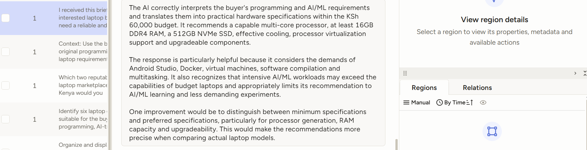
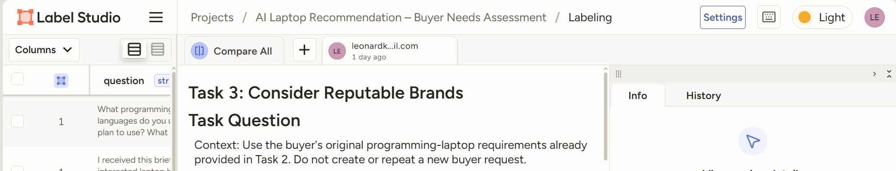
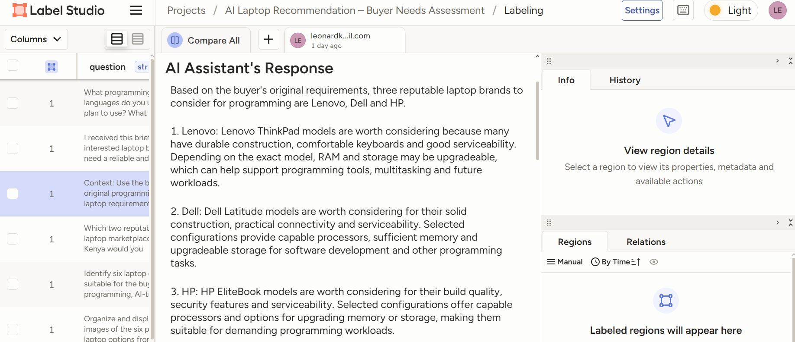

# AI Laptop Purchase Project

## Project Overview

This project documents a practical laptop purchasing exercise supported by an AI assistant. It examines how AI can help identify buyer requirements, research available laptops, compare alternatives, assess purchasing risks, and develop a professional recommendation.

The project also evaluates the quality of AI-generated responses through human annotation and feedback.

### Project Overview Screenshot

## Project Objectives

- Evaluate AI-generated responses in a realistic laptop purchasing scenario.
- Assess response relevance, accuracy, and helpfulness.
- Identify missing information, errors, and weaknesses in AI responses.
- Compare AI-generated predictions with human evaluations.
- Document evaluation results and supporting evidence.

## Task 1: Buyer Needs Assessment

### Objective

Establish the buyer's programming and computing requirements before recommending a suitable laptop.

### Prompt and AI Response

### Human Evaluation Feedback

The response correctly identified the eight areas that needed investigation, including programming languages, application development, IDE usage, virtualisation, software compilation, AI and machine learning, multitasking, and anticipated future workloads.

**Identified limitation:** The response explained what information needed to be collected but did not yet translate the questions into specific hardware requirements. The buyer's answers would be needed to establish suitable processor, memory, storage, and upgradeability requirements.

### Task 1 Outcome

The human evaluation confirmed that the AI response provided a relevant and useful starting point for understanding the buyer's needs. The information collected would guide the subsequent laptop selection process.

---

## Project Evidence

Screenshots for each task will be added progressively as the project develops. Each task will include its prompt, AI-generated response, and human evaluation evidence where applicable.

## Skills Demonstrated

- AI response evaluation
- Human annotation and feedback
- Prompt analysis
- Relevance and accuracy assessment
- Critical thinking
- Identification of AI response limitations
- Technical documentation

# AI Laptop Purchase Project

## Project Overview

This project documents a practical laptop purchasing exercise supported by an AI assistant. It examines how AI can help identify buyer requirements, research available laptops, compare alternatives, assess purchasing risks, and develop a professional recommendation.

The project also evaluates AI-generated responses through human annotation, critical review, and feedback.

### Project Overview Screenshot

## Project Objectives

- Evaluate AI-generated responses in a realistic laptop purchasing scenario.
- Assess response relevance, accuracy, and helpfulness.
- Identify missing information, errors, and weaknesses in AI responses.
- Compare AI-generated outputs with human evaluations.
- Document evaluation results and supporting evidence.

---

# Task 2: Highlight the Specifications That Meet the Buyer's Requirements

## Objective

Identify the hardware specifications required to support the buyer's programming activities, particularly AI training and machine learning, while considering the KSh 60,000 budget and anticipated future workloads.

## 1. Task Prompt

The buyer requires a reliable and powerful laptop for:

- AI training and machine learning
- Software development and web development
- Android application development
- Data science
- Virtual machines and Docker containers
- VS Code and Android Studio
- Compiling large software projects
- Running multiple applications simultaneously

The buyer also requires a capable processor, sufficient RAM, fast SSD storage, effective cooling, and good upgradeability.

## 2. AI-Generated Response

The AI translated the buyer's workload into the following recommended hardware specifications:

| Hardware Component | Recommended Specification |
|---|---|
| Processor | Intel Core i5 or i7, preferably 10th or 11th Generation, or comparable AMD Ryzen 5 |
| Processor Cores | At least 4 cores and 8 threads |
| RAM | Minimum 16GB DDR4, preferably upgradeable to 32GB or more |
| Storage | 512GB NVMe SSD |
| Cooling | Effective thermal management |
| Virtualisation | Intel VT-x or AMD-V support |
| Upgradeability | Prefer models supporting RAM and SSD upgrades |
| Operating System | Windows 11 compatibility |

### AI Response Screenshot 1

### AI Response Screenshot 2

The AI also clarified that the recommended configuration provides a practical foundation for programming, data science, and AI/ML learning within the buyer's budget. It is not intended for intensive local AI model training.

## 3. Human Evaluation Feedback

The human evaluation recognised that the AI correctly interpreted the buyer's programming and AI/ML requirements and translated them into practical hardware specifications within the KSh 60,000 budget.

The feedback highlighted the following strengths:

- Recommended a capable multi-core processor.
- Identified 16GB DDR4 RAM as the minimum requirement.
- Recommended a 512GB NVMe SSD.
- Considered effective cooling and processor virtualisation support.
- Recognised the importance of upgradeable components.
- Accounted for Android Studio, Docker, virtual machines, software compilation, and multitasking.
- Correctly limited the recommendation to AI/ML learning and less demanding experiments rather than intensive local model training.

### Identified Area for Improvement

The response could be improved by distinguishing minimum specifications from preferred specifications, particularly regarding processor generation, RAM capacity, and upgradeability. This would make the recommendations more precise when comparing actual laptop models.

### Human Evaluation Feedback Screenshot

## 4. Task 2 Outcome

The AI successfully converted the buyer's computing requirements into a practical hardware specification framework.

The human evaluation confirmed that the response addressed the major workload requirements while recognising the limitations of budget laptops for intensive local AI model training.

These specifications provide a technical foundation for the next stage of the laptop purchasing process: researching reputable laptop manufacturers and brands.

# AI Laptop Purchase Project

## Project Overview

This project documents a practical laptop purchasing exercise supported by an AI assistant. It examines how AI can help identify buyer requirements, research available laptops, compare alternatives, assess purchasing risks, and develop a professional recommendation.

The project also evaluates AI-generated responses through human annotation, critical review, and feedback.

### Project Overview Screenshot

## Project Objectives

- Evaluate AI-generated responses in a realistic laptop purchasing scenario.
- Assess response relevance, accuracy, and helpfulness.
- Identify missing information, errors, and weaknesses in AI responses.
- Compare AI-generated outputs with human evaluations.
- Document evaluation results and supporting evidence.

---

# Task 3: Consider Reputable Laptop Brands

## 1. Task Objective

Identify reputable laptop manufacturers whose products are suitable for the buyer's programming and computing requirements established in the earlier assessment.

The focus is on manufacturers with reliable business-class laptop ranges, good build quality, serviceability, capable processors, and potential for future upgrades.

## 2. Task Prompt

The AI was instructed to use the buyer's original programming-laptop requirements already provided in Task 2, without creating or repeating a new buyer request.

## 3. AI-Generated Response

The AI recommended three reputable laptop manufacturers:

### 1. Lenovo

The AI recommended Lenovo, particularly its ThinkPad range, because of:

- Durable construction.
- Comfortable keyboards.
- Good serviceability.
- Potential RAM and storage upgradeability, depending on the model.

### 2. Dell

The AI recommended Dell, particularly its Latitude range, because of:

- Solid construction.
- Practical connectivity.
- Good serviceability.
- Configurations with capable processors and upgradeable storage.

### 3. HP

The AI recommended HP, particularly its EliteBook range, because of:

- Good build quality.
- Security features.
- Serviceability.
- Capable processors.
- Options for memory and storage upgrades, depending on the model.

### AI Response Screenshot

## 4. Human Evaluation Feedback

The human evaluation confirmed that the AI correctly recommended Lenovo, Dell, and HP as reputable manufacturers of programming laptops.

The evaluation recognised that the response:

- Provided relevant reasons for considering each manufacturer.
- Addressed build quality and serviceability.
- Considered processor capabilities and upgradeability.
- Correctly explained that performance depends on the specific laptop model and configuration, not the brand name alone.

### Human Evaluation Screenshot

## 5. Task 3 Outcome

The AI successfully identified three reputable laptop manufacturers and provided relevant reasons for considering their business-class laptop ranges.

The human evaluation confirmed that the recommendations were appropriate and that the response correctly distinguished between brand reputation and the specifications of individual laptop models.

These three manufacturers provide a shortlist of brands to consider when researching reputable online laptop marketplaces in Kenya and identifying suitable laptop options.

---

## Skills Demonstrated

- AI response evaluation
- Human annotation and feedback
- Brand research and analysis
- Critical assessment of AI recommendations
- Identification of relevant product characteristics
- Evidence-based evaluation

# Task 4: Choose a Reputable Online Shop

## Task Objective

Evaluate AI recommendations for reputable online shops in Kenya where the buyer can purchase a laptop that meets their programming and AI/ML requirements.

## 1. Prompt

## 2. AI-Generated Response

The AI recommended two online marketplaces: Jumia Kenya and Kilimall Kenya.

### Jumia Kenya

The AI identified Jumia as an option because it offers:

- A wide selection of laptops from different sellers.
- Customer reviews and ratings.
- Different payment and delivery options.
- Official brand stores for some products.

**Potential risks:**
- Not every seller is manufacturer-authorised.
- Warranty coverage and return conditions may vary.
- Buyers need to verify seller credibility and product authenticity.

### Kilimall Kenya

The AI identified Kilimall as another option because it offers:

- A variety of laptop models.
- Competitive prices.
- Customer reviews and order-tracking features.

**Potential risks:**
- Products may be supplied by local or overseas sellers.
- Warranty and return conditions may vary.
- Some listings may lack sufficient hardware configuration details.

### AI's Purchasing Advice

The AI advised checking the following before placing an order:

- Seller credibility and reputation.
- Product authenticity.
- Manufacturer warranty and coverage.
- Return and refund conditions.
- Exact laptop specifications, including processor, RAM and storage.

It also emphasized that buyers should not make purchasing decisions based on price alone.

## 3. Human Evaluation and Feedback

The AI response was evaluated for relevance, accuracy and helpfulness.

**Evaluation findings:**

- The response was relevant to the buyer's request.
- It provided a useful comparison of Jumia Kenya and Kilimall Kenya.
- It highlighted important purchasing risks, including seller credibility, warranty coverage and product authenticity.
- It provided practical checks to perform before buying a laptop.

**Areas for improvement:**

The response could be more specific by identifying manufacturer-authorised dealers or official brand stores and explaining how buyers can verify them.

## 4. Task Outcome

The evaluation showed that the AI provided useful guidance for identifying online marketplaces and understanding the risks involved in purchasing laptops online.

However, the recommendations still required further verification, particularly regarding seller authorisation, product authenticity and warranty terms.

## 5. Skills Demonstrated

- AI response evaluation
- Relevance and accuracy assessment
- Critical thinking
- Risk identification
- E-commerce research
- Human evaluation and quality assurance
